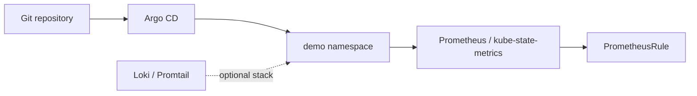

# Kubernetes GitOps and Observability Lab

A local-first platform engineering lab inspired by production operations: declarative delivery with Argo CD, resource-aware workloads, availability controls, and an alerting example. It runs on a local Kind cluster; no cloud account is required.

## What this demonstrates

- Kubernetes manifests organized with Kustomize
- Argo CD reconciliation with pruning and self-healing
- Requests, limits, HPA, and PodDisruptionBudget
- Prometheus alerting rule and an optional Kyverno policy
- A practical boundary between GitOps source and cluster bootstrap

## Architecture



## Prerequisites

- Docker
- Kind, kubectl, Helm
- An Argo CD installation in the local cluster

## Quick start

```sh
kind create cluster --name platform-lab --config kind-config.yaml
kubectl create namespace argocd
kubectl apply -n argocd -f https://raw.githubusercontent.com/argoproj/argo-cd/stable/manifests/install.yaml
kubectl apply -f argocd/application.yaml
```

The Application syncs `apps/demo` from this public repository. Check its status with:

```sh
kubectl get applications -n argocd
kubectl get deploy,svc,hpa,pdb -n demo
```

To remove the local cluster:

```sh
kind delete cluster --name platform-lab
```

## Observability

See [observability/README.md](observability/README.md) for the optional Prometheus, Grafana, Loki, and Alertmanager setup. The PrometheusRule in this repository assumes kube-prometheus-stack CRDs are installed first.

## Security policy

The optional Kyverno policy in `policies/kyverno` requires CPU and memory requests and limits for Pods. Install Kyverno before applying it. Policy is deliberately separate from the demo Application so the cluster operator opts in knowingly.

## Operational notes

- HPA and KEDA should not control the same scale target at the same time. Pick one controller for each workload.
- The PDB protects voluntary disruptions; it does not prevent node failure or guarantee application availability.
- This lab uses a public NGINX image and contains no credentials or cloud resources.

## License

MIT. See [LICENSE](LICENSE).
